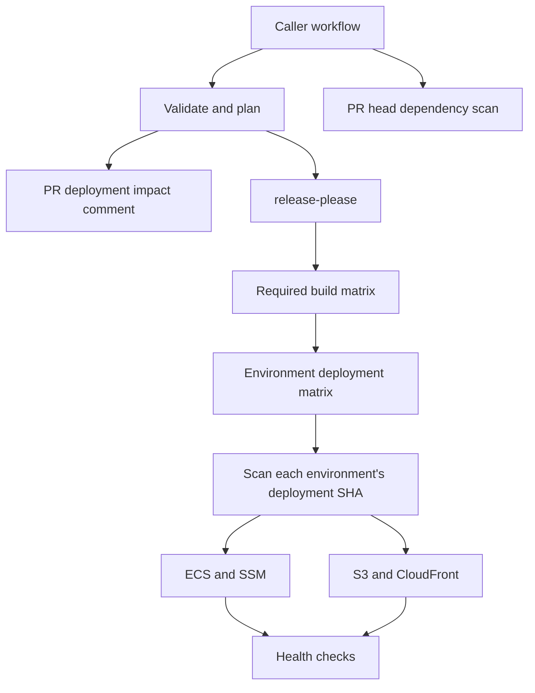

# CanadaLogin release pipeline

This repository centralizes the release pipeline used by CanadaLogin applications. A caller owns two small files:

1. `.github/workflows/release__release-pipeline.yml`, which calls the versioned public reusable workflow.
2. `.github/release-pipeline-configuration.yml`, which declares the application profile, environment list, and optional hooks.

## What it provides

- `release-please` integration to manage releases and changelogs
- `.deployed_versions/<environment>.json` files track deployed versions in source control
- ECS Fargate + ECR deployments with stability waits
- ECR immutable image management
- S3 build artifacts, S3 deployments, and CloudFront invalidations
- SBOM integration
- Trivy CRITICAL dependency vulnerability checks on PRs and before every environment deployment
- Slack start, success, build failure, and deployment failure notifications
- Repo-defined before-deploy, health-check, after-deploy, and failure hooks
- Health checks
- Multi-environment support

## Deployment behaviour

- The `dev` environment always tracks `main` and is deployed on every merge to main.
- All other environments track pinned versions in the `.deployed_versions/` directory. They deploy only when their version file is updated and merged to main.
- A manual run with **Force deployments to all enabled environments** selected deploys the current desired version to every configured environment.
- Before planning a deployment, the workflow SHA must match the caller repository's current `main` SHA. Stale runs fail before release-please, builds, or deployments can start; PR-only planning is unaffected.
- To intentionally deploy older code, manually dispatch the caller workflow with **Disable protections against deploying old code** selected (`disable_old_code_protection: true`). This override defaults to false and is honoured only for `workflow_dispatch`; `force-redeploy` and `rebuild` do not bypass the protection.
- By default, `test` is auto-incremented when a release is made using release-please. Thus `test` always tracks the latest release.
- Other higher environments are manually incremented as needed. Do so using the usual PR process.
- GitHub CODEOWNERS or branch rulesets can be used to assign required approvers to deploy to specific environments.
- Deployments are orchestrated in GitHub Actions and can be viewed from the GitHub Actions tab.

## Dependency vulnerability gates

The shared pipeline adds a **PR dependency vulnerabilities / Critical dependency vulnerabilities** check on every PR, scanning the PR head commit independently of deployment planning. Make this check required in the caller's branch ruleset if it must prevent merging. Existing callers that trigger the release pipeline on `pull_request` need no additional workflow file; callers must upgrade their shared workflow reference to a release containing this gate.

Every enabled environment also requires a fresh successful Trivy scan of **its resolved deployment SHA** before any AWS credentials, preflight, database migration, or deployment job starts. This includes `dev`, pinned releases in higher environments, manual redeploys, and promotions of already-built artifacts. A finding in current `main` does not block an environment deploying a different, clean SHA. No environment setting, `allow-failure`, or old-code override bypasses this gate.

Both checks use the same centrally pinned Trivy version and recursively scan committed dependency files, including nested applications and development dependencies. Known **CRITICAL** findings fail the check, including findings without a fix. Lower severities do not block it. Scanner and vulnerability database errors also fail closed. Findings are available in the scan job's logs. The scanner runs with read-only repository access, no AWS credentials or application secrets, and does not install or execute application dependencies. Caller-owned Trivy configuration, ignore files, and ignore policies cannot suppress findings.

Commit resolved lockfiles that match the dependencies installed by your builds. Native npm, pnpm, uv, Poetry, and other Trivy-supported lockfiles are discovered automatically; pip requirements named `requirements.txt`, `requirements-dev.txt`, `requirements.lock`, and similar variants are also recognized. Comprehensive detection considers minimum-version requirements, but these are estimates: unpinned requirements and missing transitive dependencies cannot establish the exact installed dependency set. This source dependency gate does not scan container base-image OS packages and does not replace image scanning.

## Quick start

### 1. Setup release-please configuration

See the [release-please repository](https://github.com/googleapis/release-please) for full details. At a minimum, you'll need an appropriate `release-please-config.json` file, and a `.release-please-manifest.json` file. Do not worry about invoking `release-please` from GitHub Actions, the release pipeline handles this.

You will also need to request the release-please GitHub app credentials are added to the repository secrets. Request this from CDS SRE in #sre-security-and-tooling.

### 2. Setup .deployed_versions/ files

The release pipeline uses files in `.deployed_versions/` to track the DESIRED application version for each environment. Create the directory and necessary files, see [this repository](https://github.com/cds-snc/canadalogin-user-selfservice-webapp/tree/main/.deployed_versions) as an example. A file is not needed for `dev` as it always tracks `main`.

### 3. Invoke the release pipeline from GitHub Actions

Follow the instructions in the [configuration example](examples/README.md) to set up both necessary files in your repository.

Read the [configuration guide](/docs/configuration.md) for more information on the `release-pipeline-configuration.yml` file.

## How it runs

Every required build must pass before any environment begins deployment. Components for one environment run in one job, and at most one environment job runs at a time.

## Configuration examples

There is a configuration example [here](examples/README.md).